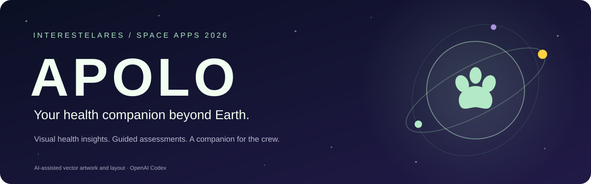

<p align="center">
  
</p>

<p align="center">
  <a href="https://miguelax0718.github.io/Interestelares/"></a>
  
  
  
</p>

# APOLO · Your health companion beyond Earth

**Team Interestelares · NASA Space Apps Challenge 2026**

Challenge: *Create Health Monitoring Software for Astronauts on Space Missions*

APOLO is an astronaut health companion that brings health indicators, sample trends, and guided assessments into one visual experience. An animated astronaut dog helps crewmembers explore their data through floating health orbs, plain-language explanations, and text or voice interaction. Built with Flutter, the application combines local rule-based tools with an optional AI gateway to explore health self-assessment when communication with Earth is delayed or unavailable.

**[Open the final project](https://miguelax0718.github.io/Interestelares/)** · [Source code](https://github.com/Miguelax0718/Insterestelares) · [Deployment guide](docs/DEPLOY.md)

> Educational hackathon prototype. The demo uses fictitious crew profiles and synthetic measurements alongside a separately identified public research reference. It is not a certified medical device or a clinically validated diagnostic or treatment system.

## The challenge and our approach

NASA's [five hazards of human spaceflight](https://www.nasa.gov/hrp/hazards/) provide our starting point: radiation, isolation and confinement, distance from Earth, gravity fields, and hostile closed environments. These interacting risks make clear health information and regular self-assessment especially relevant to long missions.

Our question is: **how can a crewmember understand what needs attention without having to interpret a wall of medical telemetry?** APOLO combines an approachable companion with a clinical dashboard, prioritizes information visually, and keeps deterministic assessment tools in the client. We aim to make daily health routines easier to understand and follow. These usability and health benefits have not yet been measured in astronaut or clinical studies.

## What we built

| Experience | What the prototype provides |
| --- | --- |
| **APOLO companion** | Animated mascot, personalized overview, floating health orbs, sample reminders, and crew selection. |
| **Eight health views** | Hydration, renal risk, bone health, radiation-related markers, immunity, cardiovascular indicators, stress and sleep, and metabolism, with sample values, trends, and explanations. |
| **Clinical dashboard** | Five modules: general health, radiation, microgravity, mental health, and triage. |
| **Radiation exploration** | A synthetic 180-day mission, cumulative effective dose, organ-dose windows, a simulated solar particle event, and a manual shelter drill. |
| **Guided assessments** | Deterministic clinical flows, contextual telemetry rules, and medication checks against bundled inventory and allergy records. |
| **Text and voice** | An optional gateway for LLM conversation, speech recognition, and speech synthesis, plus guided offline flows when the gateway is unavailable. |

The companion is the Flutter app's entry screen. An earlier standalone HTML/JavaScript prototype remains in [`web/apolo/`](web/apolo/README.md), with its own setup and behavior.

## Try APOLO

1. Open **[the published app](https://miguelax0718.github.io/Interestelares/)** and read the selected crewmember's summary.
2. Use the profile menu to switch crew. Choose **Show all**, then open a health orb to inspect its values and trends.
3. Use **Submit sample** to generate a demonstration sample. This does not collect a real biological measurement.
4. Open the modules button in the top bar to explore the five clinical tabs. In radiation, move the mission-day slider to inspect the simulated event and dose history.
5. Try text interaction. Free-form AI conversation depends on the deployed gateway; microphone use also depends on browser permissions and platform support.

**Short demo video: pending.** The live application above is available as the final-project link.

## How it works

```text
Bundled crew profiles + synthetic samples + simulated telemetry
                              |
                   Flutter + Riverpod state
                              |
           Local rule engines and domain-specific tools
                              |
              APOLO companion + clinical dashboard
                              |
                  Optional FastAPI gateway
                 /           |            \
        LLM provider    Speech-to-text    Text-to-speech
```

Local engines supply structured results to the interface and agent tools. The gateway relays conversation and voice requests; the client executes its tools. When configured, a bounded context snapshot is sent to the gateway, and LLM requests may be forwarded to the upstream model provider. See the [gateway documentation](server/README.md) for the API contract and configuration.

### Offline behavior and prototype limits

- Bundled data and deterministic logic run locally after installation or asset loading. Free-form LLM chat needs a reachable gateway and model provider; there is no embedded on-device LLM.
- Hive stores agent memory, audit records, and flags. Crew updates and APOLO's sample, water, and exercise state are currently held in memory and are not fully restored after restarting.
- Browser voice services are platform-dependent and are not guaranteed to work without internet. Web hosting alone does not guarantee a complete offline installation.
- Telemetry and sample acquisition are simulated. The roster has five members, while physical radiation data cover four; missing personal dosimetry is shown as unavailable.
- Some emergency menu entries are placeholders. Periodic proactive monitoring and durable incident logging still need integration. Severity colors and recommendations are prototype rules, not validated medical conclusions.

## Installation and development

### Flutter client

Use Flutter **3.50.0**, matching the deployment workflow, with Dart **3.14 or compatible** as required by `pubspec.yaml`. Install Git and Chrome or another supported target. Initial dependency downloads require internet.

```bash
git clone https://github.com/Miguelax0718/Insterestelares.git
cd Insterestelares
flutter pub get
flutter run -d chrome
```

The app can use local guided flows without gateway configuration. For AI conversation, pass `ASTRAMED_API_URL` and, if required, `ASTRAMED_API_KEY` through `--dart-define`; follow the [server guide](server/README.md) and [deployment instructions](docs/DEPLOY.md). Keep the upstream model-provider secret on the server. A key embedded in a web client is extractable and must not be treated as private.

On Windows, plugins may require Developer Mode for symbolic-link support. Use `flutter doctor` to check platform prerequisites.

### Optional gateway

The gateway uses Python **3.12+**, FastAPI, and `uv`. Its lightweight test setup excludes large voice-model downloads:

```bash
cd server
uv sync --python 3.12
uv run pytest -q
uv run ruff check .
```

For a running gateway, provider credentials, local voice models, fake development providers, or Docker, follow [`server/README.md`](server/README.md).

### Verification and web build

```bash
flutter analyze
flutter test
flutter build web --release
```

Local review of commit `ae69f4b` on November 15, 2026: **287 Flutter tests passed, 3 skipped**, and the web build succeeded. The skipped tests require the original Inspiration4 CBC CSV, which is not bundled. Static analysis reported 35 informational notices with the installed SDK. Gateway tests were not executed in that review because `pytest` was unavailable. These checks establish software behavior, not clinical validity.

## NASA data and resources

| Resource | Use in this project | Traceability |
| --- | --- | --- |
| [Human Research Program: five hazards](https://www.nasa.gov/hrp/hazards/) | Frames the health risks addressed by our modules. | [Challenge brief](sources/nasa/challenge_brief.md) |
| [NASA-STD-3001, Volume 1, Revision C](https://www.nasa.gov/wp-content/uploads/2023/11/nasa-std-3001-vol-1-rev-c-with-signature.pdf) | Reference quantities, units, and limits for the radiation demonstration. Effective dose and organ dose remain distinct. | [Dosimetry references and assumptions](sources/medical/radiation_dosimetry.md) |
| [OCHMO-TB-020: Design for Ionizing Radiation Protection](https://www.nasa.gov/wp-content/uploads/2023/12/ochmo-tb-020-radiation-protection.pdf) | Radiation-protection context and interpretation of dose quantities. | [Radiation module](lib/features/02_radiation/README.md) |
| [OSDR: Inspiration4, OSD-569](https://osdr.nasa.gov/bio/repo/data/studies/OSD-569) | Selected preflight and postflight complete blood count values, transcribed as a separate reference for biological variability. | [Values, unit conversion, and documented adjustment](lib/features/02_radiation/data/inspiration4_reference.dart) |
| [DONKI](https://ccmc.gsfc.nasa.gov/tools/DONKI/) / [NASA Open APIs](https://api.nasa.gov/) | Optional solar flare and energetic particle queries, with remote, cached, and synthetic fallback states. | [Space-weather adapter](lib/features/02_radiation/agent/donki_space_weather_service.dart) |
| [OCHMO-TB-031: Exercise Overview](https://www.nasa.gov/wp-content/uploads/2023/12/ochmo-tb-031-exercise-overview.pdf) | Background for exercise countermeasures and musculoskeletal context. | [Scientific bibliography](DB/references.md) |

The OSD-569 reference is separate from the demo crew's measurements. It includes a project-side adjustment to one subject/timepoint, documented in the source; this is not an official correction to NASA's dataset. The original CSV is required to reproduce the comparison tests. See NASA's [Inspiration4 dataset overview](https://www.nasa.gov/osdr-latest-news-i4-mission-datasets/) for research context.

Mission dose CSVs, generated samples, crew identities, and most telemetry are **synthetic demonstration data**, not NASA flight telemetry. Schemas and assumptions are documented in [`DB/README.md`](DB/README.md) and the [radiation sample guide](DB/samples/radiation/README.md). Urinary oxidative-stress markers are exploratory indicators; they do not replace physical dosimetry or establish radiation injury.

## Partner resources and other credits

- **Canadian Space Agency:** [Bio-Monitor](https://www.csa-asc.gc.ca/eng/sciences/bio-monitor.asp) informs the wearable-monitoring concept and simulated device catalog. No physical device integration is claimed.
- **Scientific literature:** [`DB/references.md`](DB/references.md) records the team's sources for cardiovascular monitoring, signal artifacts, vigilance, SANS, exercise, sleep, and circadian health. These references do not establish clinical validation of the implementation or every numerical threshold.
- **Client software:** [Flutter](https://flutter.dev/), [Dart](https://dart.dev/), [Riverpod](https://pub.dev/packages/flutter_riverpod), [Hive](https://pub.dev/packages/hive), and [fl_chart](https://pub.dev/packages/fl_chart). Full dependencies are in [`pubspec.yaml`](pubspec.yaml) and [`pubspec.lock`](pubspec.lock).
- **Gateway and voice:** [FastAPI](https://fastapi.tiangolo.com/), [faster-whisper](https://github.com/SYSTRAN/faster-whisper), [kokoro-onnx](https://github.com/thewh1teagle/kokoro-onnx), Piper, and an OpenAI-compatible model-provider adapter. Dependencies and model choices are documented in [`server/pyproject.toml`](server/pyproject.toml) and [`server/README.md`](server/README.md).
- **Earlier web prototype:** locally bundled Inter and Space Grotesk fonts retain their [license notices](web/apolo/fonts/). The optional REST reference uses Node.js and PostgreSQL.

Third-party software, models, fonts, and datasets retain their licenses and usage conditions. This project does not imply NASA or partner-agency endorsement.

## AI assistance disclosure

The team used **OpenAI Codex and Anthropic Claude for coding assistance**. This README and its SVG banner were also prepared with Codex assistance; the banner includes a visible credit and SVG metadata.

At runtime, APOLO optionally uses an LLM and generated speech through its configurable gateway. These are external model integrations, not models trained by the team. Synthetic datasets and their generators are identified separately from public NASA research data; synthetic does not automatically mean LLM-generated. The team should supplement this disclosure if any additional AI-generated images, video, audio, or datasets are included in the final submission.

## Team Interestelares

- Miguel Angel Elles Arroyo
- Carlos David Del Castillo Mercado
- Maria Fernanda Peña Garcia
- Juan David Campo Mercado
- Daniel Alejandro Rincon Navarro
- María Sofía Sierra Pedraza

The [team organization document](sources/notes/team_organization.md) describes the planned engineering, design, research, and testing responsibilities.

## Contributing

Useful next steps include durable local storage, validated data ingestion, completed emergency guides, periodic monitoring, accessible interfaces, and offline testing. Open an issue or propose a pull request with the problem, supporting sources, and verification steps. Never commit credentials or identifiable medical records.

## Space Apps submission

This README follows the [official Project Submission Guide](https://www.spaceappschallenge.org/resources/project-submission-guide/) by documenting the summary, solution, final project, NASA resources, other credits, and AI assistance. It does not replace the project form on the Space Apps platform.

**Pending: the short demo video link.** The guide accepts a video of **30 seconds or less**, or a presentation of **up to seven slides**, including title and introduction. Use English for the submission and linked presentation materials; a video narrated in another language needs English subtitles. Check public access without a login before submitting.

## License

No project-level `LICENSE` file is currently included; a software license has not yet been declared. Public source availability alone does not grant an open-source license. The team should choose a license before inviting reuse under specific terms. Third-party license notices remain applicable.
